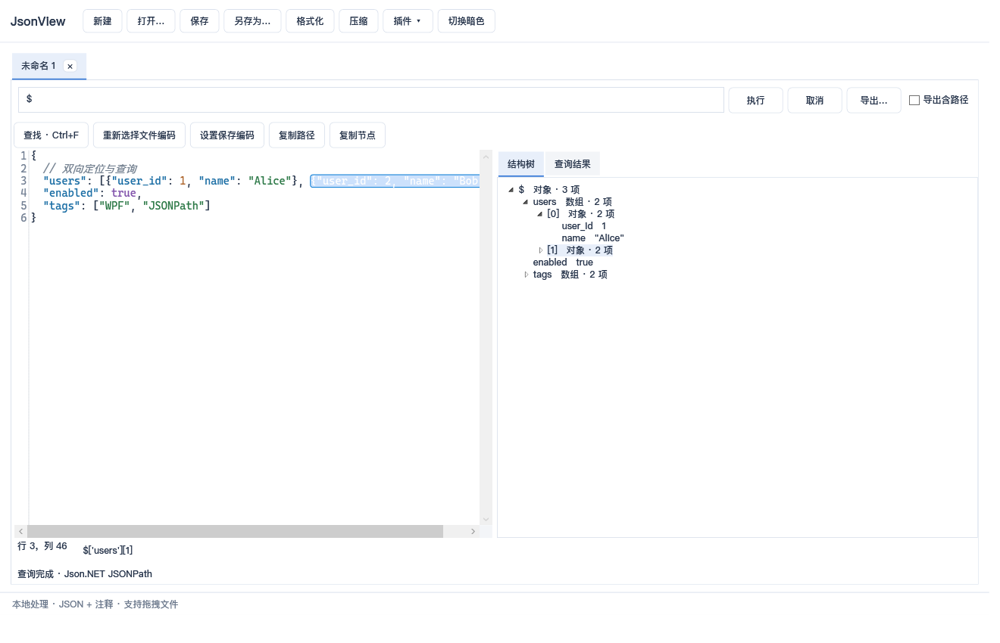
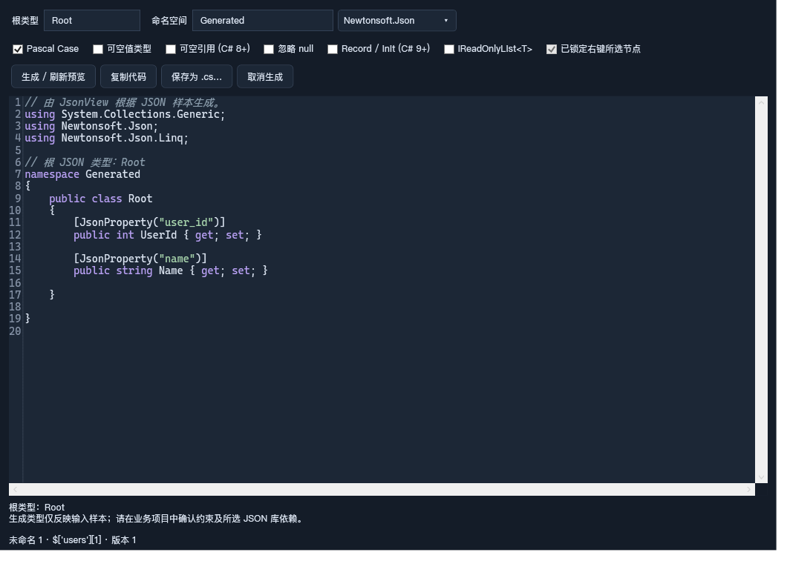
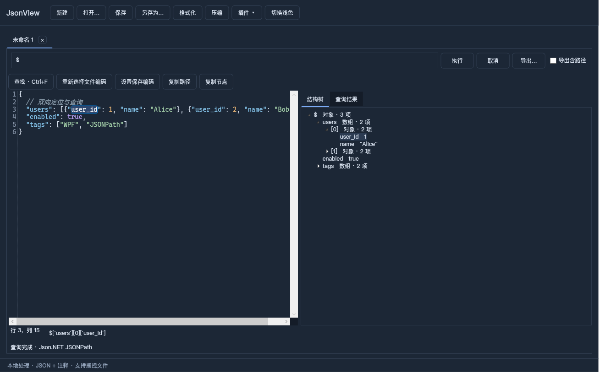

# JsonView

一个简约的 Windows JSON 查看与调试工具。左侧编辑文本，右侧浏览结构，支持双向定位、JSONPath 查询和 JSON 转 C# 实体类。

基于 **WPF / .NET Framework 4.7.2**，支持中文、浅色和暗色主题，JSON 数据在本机处理。



## 功能

- **文本与树双向定位**：点击节点定位原文，移动光标定位树节点，查看和复制 JSON 路径。
- **JSONPath 调试**：支持属性、下标、通配符、递归、过滤和切片；展示匹配数量、路径及值，支持结果导出。
- **多标签页**：直接输入、粘贴、选择或拖入 JSON 文件，各文档独立编辑和查询。
- **格式化与压缩**：默认 2 空格缩进；支持行注释和块注释，格式化保留注释，压缩移除注释，支持撤销。
- **语法检查**：非法输入提示行列位置，重复属性名报错，不覆盖原文。
- **多种编码**：UTF-8、带 BOM 的 UTF-16、GBK、GB18030，可手动选择打开及保存编码。
- **大文件浏览**：大对象和数组按需展开，超长单行采用局部排版，保留完整原文和真实位置。
- **可扩展插件**：支持本地 DLL 插件，默认附带 JSON 转 C# 实体类插件。

## 下载与运行

在 [Releases 下载最新版本](https://github.com/att1008/JsonView/releases/latest) 中下载 `JsonView-win-x64.zip`，解压后运行 `JsonView.exe`。

- Windows 10 / Windows 11，64 位。
- 需要 .NET Framework 4.7.2 或兼容的更新版本。
- 请保留解压后的 DLL 和 `Plugins` 文件夹，不要只复制 exe。

## JSON 转 C# 实体类

右键树节点，选择 **生成此节点的 C# 实体类…**，即可只生成该子树的模型。也可以通过顶部插件菜单处理整个文档。

生成结果先以 C# 语法高亮文本预览，支持复制，也可以自行选择保存为 `.cs` 文件。



| 选项 | 支持内容 |
| --- | --- |
| JSON 库 | Newtonsoft.Json（默认）或 System.Text.Json |
| 命名 | 可选 Pascal Case，使用对应库的特性保留原始 JSON 属性名 |
| 可空类型 | 分别控制可空值类型与可空引用类型 |
| 忽略 null | 输出所选库对应的忽略 null 属性配置 |
| Record | 可选显式属性 record，使用 get/init |
| 只读列表 | 可选 IReadOnlyList<T>，默认 List<T> |

数组会扫描全部样本合并字段；遇到缺失字段、混合类型或无法可靠推断的类型时提供提示。右键生成会锁定所点节点的快照，切换标签页不会改变输入范围。

## 快速使用

1. 输入 JSON，或选择/拖入文件，等待解析完成。
2. 点击右侧节点查看原文及路径，或在左侧移动光标反向定位。
3. 输入 JSONPath，按 Enter 或点击执行。例如：

   ```text
   $['users'][0]
   $..name
   $['users'][?(@.age >= 18)]
   $['users'][0:10:2]
   ```

4. 点击查询结果定位原文；按需导出匹配值数组，或包含 path/type/value 的记录数组。

| 快捷键 | 操作 |
| --- | --- |
| Ctrl+N | 新建标签页 |
| Ctrl+O | 打开文件 |
| Ctrl+S | 保存 |
| Ctrl+W | 关闭当前标签页 |
| Ctrl+F | 查找 |

无 BOM 文件默认按严格 UTF-8 读取。GBK/GB18030 文件可使用“重新选择文件编码”；“设置保存编码”只影响之后的写入，不重新解释当前文本。

## 暗色主题



## 从源码构建

需要 Windows、支持 SDK 项目的 .NET SDK / MSBuild，以及 .NET Framework 4.7.2 Developer Pack。

```powershell
dotnet build JsonView.sln -c Release
.\src\JsonView\bin\Release\net472\JsonView.exe
```

运行验证：

```powershell
.\tests\JsonView.Verification\bin\Release\net472\JsonView.Verification.exe
```

生成代码的编译验证还需要支持 C# 9 的 Visual Studio Roslyn 编译器。验证程序会通过 vswhere 自动查找，也可以通过 `JSONVIEW_CSC` 指定 `csc.exe`，通过 `JSONVIEW_FRAMEWORK_REFERENCES` 指定 net472 参考程序集目录。

## 插件

将插件放入 `Plugins/<插件名称>/`，目录中包含 `plugin.json`、入口 DLL 及必要依赖，重启后加载。默认插件清单可参考 `src/JsonView.CSharp/plugin.json`。

入口实现 `IJsonViewPlugin`；需要树节点右键命令时，可额外实现 `IJsonNodePlugin`。契约定义位于 `src/JsonView.Contracts/PluginContract.cs`。插件启用、禁用及更新均在重启后生效。

插件以当前进程权限运行，请仅安装可信插件。

## 使用边界

- 支持严格 JSON 加 `//` 与 `/* ... */` 注释，不支持尾随逗号、JSON5 和多个根值；最大嵌套深度为 256。
- JSONPath 使用 Json.NET 方言。超出 decimal 精确范围的小数在查询时会提示限制，原文查看、格式化及压缩仍保留数值文本。
- 超过 16,000 字符的逻辑行会明确显示折叠片段，原文不变，可用树或查找定位，也可显式格式化。跨片段的长字符串/注释着色可能不完整。
- 可空引用类型需要消费项目支持 C# 8+；Record/init 需要 C# 9+，旧框架项目还需检查 IsExternalInit 兼容定义。
- 已验证约 30 MB、12 万元素样本；实际表现取决于数据结构和设备。当前开发环境为 Windows 11，Windows 10 和不同系统 DPI 尚未完成实机验证。

## 问题反馈

欢迎通过仓库的 Issues 反馈问题。请附上复现步骤、系统版本和脱敏后的最小 JSON 示例。

## 许可证

本项目暂未指定开源许可证。第三方组件的许可证与版权声明见 [licenses](licenses)。
